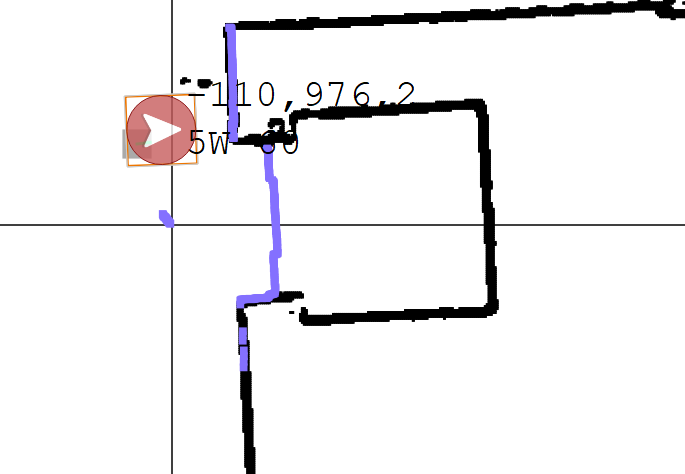
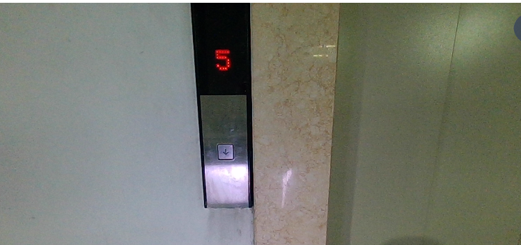

# 电梯按钮观察 → 入梯 → 识别 20 楼 → 出梯测试

日期：2026-10-14；头部控制更新：2026-10-15。程序及文档先保存在本地 `E:\book_project\yolo_v8\test`。

**2026-10-15 单文件部署更新：下位机只需复制 `elevator_button_floor_main.py` 到现有 `book` 目录。**默认参数、流程和结果校验已内置；无需在下位机解压整个包。优先按《下位机单文件部署.md》操作。下面的完整包部署保留供上位机或需要完整测试文件的环境使用。

## 1. 本次演示做什么

1. 机器人初始位于原有门外原点，面向电梯；导航到图一中的按钮观察点。
2. 只判断图二的**下行呼梯按钮本体**是否点亮。未亮、看不清或识别出错时不继续移动，等待新观察；超时后结束本轮。确认点亮才返回原点。
3. 使用已有门感知，等待电梯门完整打开后进入轿厢，并沿用已有入梯动作转身面向门。
4. 头部向右上方观察轿厢楼层显示屏；连续两张不同图像明确读到 **20** 后，头部回到看门姿态。
5. 使用**转头完成之后的新图像**判断门是否完整打开；确认后使用已有出梯导航退出。

本程序不按厅外按钮，也不选择轿厢内楼层。测试人员需要正常召梯、选择 20 楼；机器人只观察、等待和进出电梯。“未按上就不懂”按“未按上就不动”实现。

这是按本次指定流程编写的演示，不是前面讨论的自主 LLM 规划系统。

## 2. 文件和现有程序的关系

| 文件 | 用途 |
| --- | --- |
| `elevator_button_floor_main.py` | 下位机单文件新入口，内置参数、流程和校验，调用现有 `book/api.py` |
| `elevator_extra_perception.py` | 上位机附加节点，调用已有 VLM 客户端识别按钮和屏幕 |
| `elevator_demo_core.py` | 上位机输出解析及兼容导出；下位机不需要复制 |
| `params/elevator_button_floor_demo.json` | 上位机配置；下位机可用 `--config` 显式选择，默认使用单文件内置参数 |
| `deploy/run_extra_perception.sh` | 上位机启动附加节点，读取已有密钥配置 |
| `tests/test_elevator_demo.py` | 无 ROS、无硬件、无 API 的行为回归测试 |
| `验证记录.md` | 本地测试及上下位机只读检查结果 |
| `assets/` | 用户提供的两张原始参考图 |

继续使用原来的上位机 `Demo_vlm2_kuavo_api/deploy/run_ros_api.sh` 判断门状态。新节点仅负责按钮和楼层，不修改现有感知工程、`all-test-2115-main.py` 或 `elevator_text_main.py`。

下位机仅运行新入口；不要同时运行旧 `elevator_text_main.py --run` 或其他导航任务。现场 `/robot_head_motion_data` 曾发现 `/kb_head_control` 发布者，完整演示前需要避免其他程序持续发送头部姿态，否则会覆盖看屏幕/看门的角度。

## 3. 坐标与头部视角：先核对，再整轮运行

### 3.1 坐标来源和单位

参考下位机当前 `all-test-2115-main.py`：导航接口的位置单位是**米**，角度是**度**；其中地图截图的位置按**毫米除以 1000**写入配置。图一 `(110, 976)` 暂按机器人位姿坐标处理，不是截屏像素位置，不需要通过相机坐标反投影。

| 点位 | X / m | Y / m | 朝向 / deg | 来源 |
| --- | ---: | ---: | ---: | --- |
| 原点 `origin` | -3.465 | -0.216 | 0 | 现场原进出梯配置 |
| 按钮点 `button` | **0.110** | **0.976** | **2** | 用户给出的 110、976；朝向暂取图一第三个数 2 |
| 入梯点 `inside` | 2.256 | 0.083 | -178 | 现场原进出梯配置 |
| 出梯点 `exit` | -3.465 | -0.216 | 180 | 现场原进出梯配置 |

**按钮点是候选值，不是实测确认值。**图一 X 前的符号被图形遮挡，用户也未确认；如果 JnManager 完整读数是 `-110`，请将新配置的 `points.button.x` 改为 `-0.110`。不要写成 `110` 米。现场已有 `navigation.yaml` 中旧按钮点是 `(-0.160, 0.778, -1°)`，可作为附近位置的参照，不能冒充本次新点位。

用户说明 20 楼与 21 楼布局完全相同，本演示按此说明复用 `21floorrr` 的局部进出梯坐标；不调用切图或重定位服务，不写业务楼层记录。布局相同仍需现场确认出梯方向和局部坐标对齐；本测试不接后续跨楼层巡航。



### 3.2 头部角度

本版使用用户找到的 `api.NodeHeadMove`，在行为树中逐次执行，等待节点成功后再进入观察阶段。该节点内部仍通过 `HeadAPI.control_head(yaw_deg, pitch_deg)` 向 `/robot_head_motion_data` 发布度制目标角度。

用户文档范围为 yaw `[-90,90]`、pitch `[-20,45]`。2026-10-15 核对的当前 `ControlDataManager.h` 控制源码另有 yaw `[-88,88]`、pitch `[-25,25]` 限制，因此本演示采用两者交集：**yaw `[-88,88]`、pitch `[-20,25]`**。此前消息文件注释中的 `[-30,30]` / `[-25,25]` 不能直接视为当前机器人完整限位。

同日读取当前 ROS `/robot_description`，模型为 `biped_s62`：头部 yaw 关节轴为 `+Z`，pitch 关节轴为 `+Y`。按机器人 X 向前、Y 向左、Z 向上的坐标约定推导，**负 yaw 向右，负 pitch 抬头**。代码示例中的 `name="LookDown"` 只是节点名称，不决定实际转动方向。此推导尚未通过实机动作验证，标定时仍以相机画面为准。

初始配置：

| 视角 | yaw / deg | pitch / deg |
| --- | ---: | ---: |
| 看厅外按钮 `button` | 0 | 0 |
| 看右上方屏幕 `floor` | -20 | -10 |
| 看门 `door` | 0 | 0 |

`(-20,-10)` 是更新后的待标定候选，替换之前未验证的 `(-20,+15)`。需要根据相机画面调整，不能保证初始值就能拍到屏幕。程序使用如下节点，并持续执行到其返回成功：

```python
head_move = api.NodeHeadMove(
    name="LookRightUp",
    head_api=head_api,
    yaw=-20.0,
    pitch=-10.0,
    wait_time=2.0,
)
```

仅创建节点不会发送动作，需要交给行为树执行或调用其 `tick_once()`。现有节点发送一次角度指令，再等待 `wait_time`；它没有根据关节实测角度确认到位，也没有自动将屏幕居中。

单文件顶部的 `DEFAULT_CONFIG` 暂为 `'calibrated': False`。完成按钮点、三个视角和局部进出梯位置复核后，在**下位机新入口文件**中改为 `True`。如果明确传了 `--config`，则修改对应 JSON 的 `"calibrated": true`。原程序的三个现场确认参数保留，没有更改原部署配置。

## 4. 将本地包分别放到上下位机

已提供 `elevator_button_floor_demo.tar.gz`，里面的顶层目录是 `elevator_button_floor_demo`，包含程序、配置、文档和测试，不含密钥。

本地 PowerShell：

```powershell
cd E:\book_project\yolo_v8
scp .\test\elevator_button_floor_demo.tar.gz leju_kuavo@192.168.5.244:/tmp/
scp .\test\elevator_button_floor_demo.tar.gz lab@192.168.5.133:/tmp/
```

上面是完整包的可选安装方式。**下位机推荐只上传单个 Python 文件，具体命令见《下位机单文件部署.md》；无需执行第二条压缩包上传命令。**

上述 SSH 地址是本次实际连通的地址。如果网络变更，替换成当前可用地址。

上位机解压：

```bash
tar -xzf /tmp/elevator_button_floor_demo.tar.gz -C /media/data/vlm
cd /media/data/vlm/elevator_button_floor_demo
```

下位机解压：

```bash
sudo su
cd /home/lab/kuavo-ros-control
source devel/setup.bash
cd src/kuavo_humanoid_sdk/kuavo_humanoid_sdk/kuavo_strategy_pytree/book
tar -xzf /tmp/elevator_button_floor_demo.tar.gz -C .
cd elevator_button_floor_demo
```

## 5. 启动上位机：两个终端

先沿用已有相机、ROS Master 和机器人运行环境。两个上位机程序与下位机必须连接同一个 ROS Master；本次只读检查使用：

```bash
export ROS_MASTER_URI=http://kuavo_master:11311
```

不要只 source ROS 后沿用默认 localhost Master。`ROS_IP` 使用本机机器人局域网地址：本次上位机配置是 `192.168.26.12`，下位机是 `192.168.26.1`，与 Windows 连接用的 SSH 地址不同。

**终端 A：原有门状态感知，保持原命令。**

```bash
cd /media/data/vlm/Demo_vlm2_kuavo_api
./deploy/run_ros_api.sh
```

**终端 B：新增按钮/楼层感知。**

```bash
cd /media/data/vlm/elevator_button_floor_demo
bash deploy/run_extra_perception.sh
```

新启动脚本读取已有 `/media/data/vlm/secrets/elevator_vlm_api.env`，复用已有模型和 API 客户端，不需要把密钥复制到本地或新测试目录。

原节点只在看门阶段推理；附加节点只在按钮和楼层阶段推理。下位机切换两个节点的工作状态，转头或导航时暂停推理。

## 6. 下位机分步检查

进入下位机新目录并使用与原程序相同的 ROS / SDK 环境：

```bash
sudo su
cd /home/lab/kuavo-ros-control
source devel/setup.bash
cd src/kuavo_humanoid_sdk/kuavo_humanoid_sdk/kuavo_strategy_pytree/book/elevator_button_floor_demo
```

### 6.1 无硬件预览和模拟

```bash
python3 elevator_button_floor_main.py
python3 elevator_button_floor_main.py --mock
python3 -m unittest discover -s tests -q
```

默认只显示参数；`--mock` 只验证阶段顺序，不连接机器人、不调用 API。

### 6.2 只读连接检查

启动上位机两个节点之后：

```bash
python3 elevator_button_floor_main.py --check-services
```

检查头部相机、门感知、附加感知、导航服务及头部订阅者，不调用导航、头部动作或切图服务。若提示缺少 `/elevator/perception/state`，先检查终端 A；若缺少 `/elevator/demo/state`，检查终端 B。

### 6.3 头部视角标定

机器人位于适当观察位置、已有控制环境正常时，仅测试头部姿态：

```bash
python3 elevator_button_floor_main.py --head-only floor --estop-ready
python3 elevator_button_floor_main.py --head-only door --estop-ready
```

在相机画面上确认屏幕是否完整可见、看门姿态是否恢复正常。首次可以先把下位机单文件顶部 `DEFAULT_CONFIG` 的 `head` → `floor` 设为 `{'yaw': -5.0, 'pitch': -5.0}`，确认右上方向后再逐步调整到屏幕完整可见。修改后重复命令即可；`--head-only` 不移动底盘，允许在 `calibrated=False` 时标定。使用外部 JSON 时需在命令中显式加 `--config`。

### 6.4 原地感知检查

保持已经对准的视角，仅启动识别，不转头、不导航：

```bash
python3 elevator_button_floor_main.py --observe-only button
python3 elevator_button_floor_main.py --observe-only floor
python3 elevator_button_floor_main.py --observe-only door
```

各命令分别等待“下行按钮已亮”“显示 20 楼”“门完整打开”。条件未满足时继续等待；查看实时读数可以另开终端：

```bash
rostopic echo /elevator/demo/state
rostopic echo /elevator/perception/state
```

按钮应区分 `button_lit=false`（明确未亮）和 `null`（看不清），楼层显示 5 应输出 `floor=5`，不得因为目标为 20 就报告 20。楼层识别提示中不传入目标楼层，20 的比较在控制侧完成。

图二的上方红色 **5** 是楼层屏幕，不是按钮灯；按钮周围白色/紫色反光也不能直接判成点亮。



如目标太小，修改**上位机**新配置的 `camera.button_roi` 或 `camera.floor_roi`，格式为原始图像像素 `[x, y, width, height]`，修改后重启终端 B。默认 `null` 使用整图，不将参考照片尺寸或坐标直接用于机器人相机。本次实际头部相机为 **848×480、YUYV**。

## 7. 整轮演示

确认原点、按钮点及头部视角后，将下位机新入口文件顶部 `DEFAULT_CONFIG` 中的 `'calibrated': False` 改成 `'calibrated': True`。如果使用外部 JSON，需要显式传 `--config`。机器人初始需在原点 `(-3.465, -0.216, 0°)`，当前局部导航坐标与 `21floorrr` 对齐；程序不会自动定位或导航到初始原点。

```bash
python3 elevator_button_floor_main.py --run --preflight-confirmed --perception-confirmed --estop-ready
```

预期日志：

```text
[1/6] 从原点前往厅外按钮观察点
[2/6] 等待下行按钮点亮；未亮/未知时原地等待，不自动按键
[3/6] 等待门完整打开后进入，并转身面向门
[4/6] 头部看右上方，等待显示 20 楼
[5/6] 确认 20 楼后，转头面向门，等待新画面确认完整开门
[6/6] 退出电梯
单轮演示完成。
```

本次沿用现场原导航速度及关闭避障配置：线速度 `0.7`、角速度 `0.4`、`avoid_enabled=False`，可在下位机内置参数里调低速度。现场看护和急停要求沿用旧进出梯测试；退出 Python 脚本本身不保证底盘已停止。

## 8. 测试用例和通过条件

| 用例 | 通过条件 |
| --- | --- |
| 厅外按钮未亮 | 原地等待，不返回原点、不进入电梯；超时结束本轮 |
| 只有屏幕数字发红光 | 不据此确认按钮点亮 |
| 按钮有金属反光/过曝 | 无法区分时输出未知，不放行 |
| 按钮明确点亮 | 两张不同新图像确认后，返回原点 |
| 门关闭、半开或运动中 | 沿用原完整开门规则，不进入/退出 |
| 入梯导航或转身失败 | 不进入看屏幕阶段，结束本轮 |
| 轿厢屏幕显示 19 或 21 | 不切到看门阶段，不退出 |
| 屏幕显示 20 | 两张不同新图像确认后才回头看门 |
| 屏幕模糊、遮挡或缺段 | 持续等待新观察，不猜楼层 |
| 识别结果属于转头前/旧请求 | 丢弃；不能推进当前阶段 |
| 相同图像重复返回、API 错误或结果过期 | 不累计有效确认 |
| 确认 20 楼后门仍关闭 | 继续等待，不移动底盘 |
| 转回看门后完整开门 | 接受新鲜有效结果，再执行出梯导航 |

默认按钮等待最多 300 秒、楼层等待最多 600 秒、每次等门最多 300 秒。超时结束本轮，不自动重试导航、不自动按键。

按钮和楼层连续确认均要求两张不同图像，图像时间跨度至少 1 秒；门开放确认采用 `all-test-2115-main.py` 当前的一帧有效结果规则。结果图像最长允许 15 秒；转头后重新设置观察时间屏障，避免复用入梯前的门图像。

连续确认减少抖动，但不能代替现场视觉准确率测试；VLM 自报 confidence 不是已经校准的正确率。显示 20 也不单独证明电梯已经停稳，因此仍需后续完整开门条件，本演示依赖测试人员正常选择 20 楼停靠。

## 9. 运行记录和故障定位

下位机运行记录位于新目录 `logs/elevator_*.jsonl`，包括导航点、头部角度、观察请求和实际采用的识别结果，不记录 API 密钥。

| 现象 | 检查内容 |
| --- | --- |
| SSH 可以连接，但 ROS 无法连接 | `ROS_MASTER_URI` 是否仍指向 `kuavo_master:11311`，上下位机局域网地址是否正确 |
| 到按钮点后一直等待 | 实际按钮是否点亮、相机是否拍到按钮、上方屏幕是否产生干扰 |
| 一直无法识别 20 | 屏幕是否完整进入画面、头部角度是否被其他发布者覆盖、字是否太小 |
| 所有结果都过期 | 相机时间戳、上下位机时钟及 API 往返耗时；不要用扩大超时掩盖视角或网络问题 |
| 转头后仍使用旧结果 | 检查 `/elevator/demo/observe` 的新 request_id 和结果中的 request_id |
| 只读检查没有门节点 | 终端 A 的原 `run_ros_api.sh` 是否启动成功 |

## 10. 当前验证范围

本地行为回归、预览和模拟已通过；上下位机 Python 3.8.10 兼容检查、现有 API 接口检查和真实头部相机 YUYV 解码已通过。

本次未上传部署新包，未启动真实导航/头部动作，未执行按键、切图或整轮乘梯；按钮和 20 楼屏幕的真实 VLM 效果、按钮坐标符号以及头部候选角度，仍需按上述分步测试现场确认。详见 `验证记录.md`。
